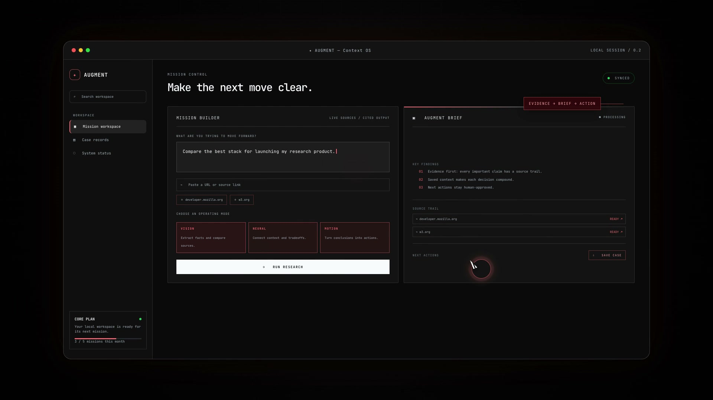

# AUGMENT Context OS

> A calm research-to-action workspace for turning a mission into cited evidence, persistent context, and the next useful move.

[](https://augment-design.vercel.app/)
[](https://github.com/sumitkumarraju/augment-design)
[](https://react.dev/)
[](https://www.typescriptlang.org/)
[](https://vite.dev/)



## Overview

AUGMENT is a source-grounded workspace for builders, researchers, founders, and creators. Start with a mission, add context, review a structured brief, and save the result as a reusable case record.

The product is organized around one loop:

**Research → Context → Decision → Next Action**

## What it does

- **Mission Builder** — define the question or decision you want to move forward.
- **Three operating modes** — use **VISION** to compare facts, **NEURAL** to connect context and tradeoffs, or **MOTION** to turn conclusions into actions.
- **Live source handling** — add URLs and discover relevant Wikipedia and OpenAlex sources.
- **Cited briefs** — review findings with a visible source trail and readable excerpts.
- **Reliable run states** — see progress, partial failures, retry controls, timeouts, and cancellation.
- **Case records** — save complete briefs, sources, findings, warnings, and next actions locally.
- **Light boot experience** — a MacBook-style intro that matches the site’s glass OS visual language and supports reduced motion.

## Live demo

Visit **[augment-design.vercel.app](https://augment-design.vercel.app/)**. Source: **[github.com/sumitkumarraju/augment-design](https://github.com/sumitkumarraju/augment-design)**.

The project also includes a 15-second product walkthrough at [`brag.mp4`](./brag-output-2026-10-26-233610/brag.mp4).

## Run locally

### Requirements

- Node.js 20 or newer
- npm

### Install and start

```bash
npm install
npm run dev
```

Open [http://localhost:5173](http://localhost:5173).

### Production checks

```bash
npm run lint
npm run build
npm run preview
```

## Configuration

Create a local `.env.local` file only when you need a custom URL reader:

```bash
VITE_RESEARCH_READER_URL=https://your-reader.example.com
```

Without this variable, provided URLs use the public Jina reader fallback. Wikipedia and OpenAlex are used for source discovery in the browser MVP.

## Architecture

The research flow lives in [`src/lib/researchService.ts`](./src/lib/researchService.ts). Provider adapters normalize results into a shared source model, apply request timeouts and retries, preserve source errors, and map findings back to citations.

The primary product surface is [`src/components/MissionWorkspace.tsx`](./src/components/MissionWorkspace.tsx). Saved case records currently use browser storage so the experience works without an account or backend.

See [`docs/research-architecture.md`](./docs/research-architecture.md) for the reliability rules and the planned server-side worker architecture.

## Project structure

```text
src/
├── components/       Product surfaces and visual system
├── lib/              Research providers and brief normalization
├── App.tsx           Application composition
└── index.css         Global theme and boot animation styles
docs/                 Architecture notes
public/               Static assets
brag-output-*/        Product walkthrough and Hyperframes composition
```

## Production roadmap

The current browser MVP is designed for low-volume, human-reviewed research. Before high-volume production use, move provider calls behind an authenticated server-side API or worker for:

- API credentials and rate limiting
- SSRF protection for user-provided URLs
- durable jobs, caching, and persistence
- server-side observability and provider health tracking

## License

No open-source license is currently included. All rights reserved.
