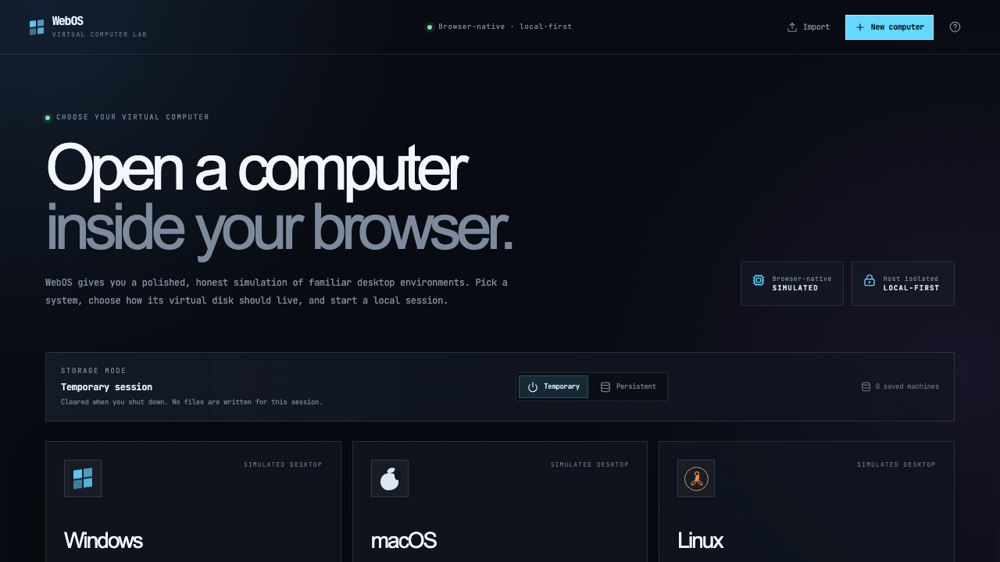

# WebOS — Virtual Computer Lab

> A browser-native virtual computer lab with simulated Windows, macOS, and Linux desktop experiences.

WebOS opens a computer inside a responsive laptop frame. Choose an operating system, boot through its own startup sequence, and use a shared virtual filesystem across File Manager, Terminal, Text Editor, and the other registered applications. The existing AUGMENT source-grounded research workspace is available as the **AUGMENT Workspace** desktop application.

[](https://augment-design.vercel.app/)
[](https://github.com/sumitkumarraju/augment-design)
[](https://react.dev/)
[](https://www.typescriptlang.org/)
[](https://vite.dev/)



## Product preview

The screenshot above shows the WebOS machine manager. Select a simulated Windows, macOS, or Linux desktop, choose temporary or persistent local storage, and launch a complete browser-based computer session.

## WebOS overview

- OS selection manager with Windows, macOS, and Linux-inspired experiences.
- OS-specific simulated boot screens: Windows loading dots, macOS progress bar, and Linux startup messages.
- Responsive virtual laptop hardware with a screen bezel, webcam detail, chassis, keyboard deck, and trackpad.
- Reusable desktop window manager with focus, z-order, dragging, resizing, minimize/maximize, taskbars, Docks, launchers, and context menus.
- Isolated virtual filesystem with directories, files, trash/restore, copy/move, search, quotas, import/export, and shared Terminal/File Manager state.
- Temporary in-memory sessions and persistent IndexedDB-backed local sessions.
- Multiple isolated machine configurations with duplication, deletion, and validated machine exports.
- Functional File Manager, Terminal, Text Editor, Browser boundary, Calculator, Notes, Calendar, System Monitor, Settings, Application Store, and AUGMENT Workspace.

## Existing AUGMENT workspace

AUGMENT is a source-grounded workspace for builders, researchers, founders, and creators. Start with a mission, add context, review a structured brief, and save the result as a reusable case record.

The product is organized around one loop:

**Research → Context → Decision → Next Action**

## What it does

- **Mission Builder** — define the question or decision you want to move forward.
- **Three operating modes** — use **VISION** to compare facts, **NEURAL** to connect context and tradeoffs, or **MOTION** to turn conclusions into actions.
- **Live source handling** — add URLs and discover relevant Wikipedia and OpenAlex sources.
- **Cited briefs** — review findings with a visible source trail and readable excerpts.
- **Reliable run states** — see progress, partial failures, retry controls, timeouts, and cancellation.
- **Case records** — save complete briefs, sources, findings, warnings, and next actions locally.
- **Light boot experience** — a MacBook-style intro that matches the site’s glass OS visual language and supports reduced motion.

## Live demo

Visit **[augment-design.vercel.app](https://augment-design.vercel.app/)**. The source repository is **[github.com/sumitkumarraju/augment-design](https://github.com/sumitkumarraju/augment-design)**.

The project also includes a 15-second product walkthrough at [`brag.mp4`](./brag-output-2026-10-26-233610/brag.mp4).

## Run locally

### Requirements

- Node.js 20 or newer
- npm

### Install and start

```bash
npm install
npm run dev
```

Open [http://localhost:5173](http://localhost:5173).

### Production checks

```bash
npm run lint
npm run build
npm run preview
```

## Configuration

Create a local `.env.local` file only when you need a custom URL reader:

```bash
VITE_RESEARCH_READER_URL=https://your-reader.example.com
```

Without this variable, provided URLs use the public Jina reader fallback. Wikipedia and OpenAlex are used for source discovery in the browser MVP.

## Architecture

The WebOS shell lives in [`src/webos/WebOSApp.tsx`](./src/webos/WebOSApp.tsx). The filesystem and storage layers are intentionally separate from the UI: [`src/webos/filesystem.ts`](./src/webos/filesystem.ts) implements virtual paths and file operations, while [`src/webos/persistence.ts`](./src/webos/persistence.ts) handles machine metadata, IndexedDB persistence, and validated exports.

The research flow remains in [`src/lib/researchService.ts`](./src/lib/researchService.ts), and its existing workspace is mounted by [`src/webos/components/Applications.tsx`](./src/webos/components/Applications.tsx) as a registered application.

The primary product surface is [`src/components/MissionWorkspace.tsx`](./src/components/MissionWorkspace.tsx). Saved case records currently use browser storage so the experience works without an account or backend.

See [`docs/research-architecture.md`](./docs/research-architecture.md) for the reliability rules and the planned server-side worker architecture.

## Project structure

```text
src/
├── webos/             Machine manager, desktop shell, apps, filesystem, storage
│   ├── components/    Laptop, boot screens, desktop, windows, applications
│   ├── filesystem.ts  Isolated virtual filesystem API
│   ├── persistence.ts IndexedDB/local persistence and import/export
│   └── WebOSApp.tsx   Entry point and machine lifecycle
├── components/        Existing AUGMENT research surfaces
├── lib/               Research providers and case storage
├── App.tsx            WebOS application composition
└── index.css          Shared global styles
docs/                 Architecture notes and WebOS plan
public/               Static assets
brag-output-*/        Product walkthrough and Hyperframes composition
```

## Browser boundaries

WebOS is a simulated desktop. It does not boot a Windows, macOS, or Linux kernel, and it never runs terminal commands on the host. The internal browser does not bypass iframe or same-origin policy; external pages open in a normal browser tab. Persistent browser storage is quota-bound and temporary-session cleanup cannot be guaranteed after a crash or force quit.

The manager includes official Microsoft and Apple download links and lets users stage ISO/DMG metadata for a session. It does not download, upload, execute, or bundle proprietary operating-system media. Microsoft’s Media Creation Tool is Windows-only; Apple’s current installer flow produces an installer app rather than a browser-bootable DMG.

## Production roadmap

The current browser MVP is designed for low-volume, human-reviewed research. Before high-volume production use, move provider calls behind an authenticated server-side API or worker for:

- API credentials and rate limiting
- SSRF protection for user-provided URLs
- durable jobs, caching, and persistence
- server-side observability and provider health tracking

## License

No open-source license is currently included. All rights reserved.
